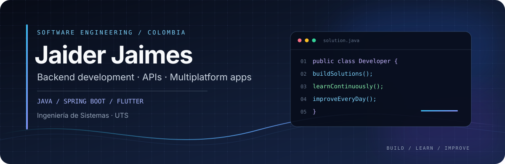

  

  **Desarrollador de software · Backend & aplicaciones multiplataforma**

  Bucaramanga, Colombia · Estudiante de Ingeniería de Sistemas en las UTS

  
  

---

## Perfil

Me enfoco en desarrollar **aplicaciones web y móviles**, con especial interés en **Java, Spring Boot, APIs REST y bases de datos**. También trabajo con Flutter para crear experiencias multiplataforma y con herramientas como Docker para organizar entornos de desarrollo.

Me gusta convertir requisitos en soluciones funcionales, estructurar el código con claridad y seguir fortaleciendo mis fundamentos de ingeniería de software mediante proyectos prácticos.

## Stack tecnológico

  

| Área | Tecnologías |
|---|---|
| **Lenguajes** | Java · Dart · JavaScript · Python · PHP |
| **Backend** | Spring Boot · Spring Security · NestJS · Thymeleaf · APIs REST |
| **Móvil y multiplataforma** | Flutter · Provider |
| **Datos** | MySQL · PostgreSQL · SQLite · MongoDB · Firebase Firestore |
| **Infraestructura** | Docker · Nginx · Linux · Microsoft Azure |
| **Herramientas** | Git · VS Code · NetBeans · MySQL Workbench |

## Proyectos destacados

<table>
  <tr>
    <td width="50%" valign="top">
      <h3><a href="https://github.com/jaider17-01/clubmongo-api">01 / ClubMongo API</a></h3>
      
API REST para gestionar clubes, jugadores, asociaciones y competiciones. Incluye reglas de integridad en la capa de servicio, persistencia con MongoDB, configuración con Docker Compose y un cliente web básico.

      
<strong>Java 17 · Spring Boot 3 · MongoDB · Docker</strong>

      <a href="https://github.com/jaider17-01/clubmongo-api">Explorar repositorio →</a>
    </td>
    <td width="50%" valign="top">
      <h3><a href="https://github.com/jaider17-01/uts-infofix-full">02 / UTS InfoFix</a></h3>
      
Aplicación multiplataforma para reportar y hacer seguimiento a fallas en laboratorios universitarios. Contempla lectura de códigos QR, roles de usuario y un panel para técnicos. Documentación basada en IEEE 830.

      
<strong>Flutter · Dart · Provider · Firebase</strong>

      <a href="https://github.com/jaider17-01/uts-infofix-full">Explorar repositorio →</a>
    </td>
  </tr>
  <tr>
    <td colspan="2" valign="top">
      <h3><a href="https://github.com/jaider17-01/sistema-web-farmacia">03 / Sistema Web de Farmacia</a></h3>
      
Proyecto de grado en desarrollo orientado a la gestión de una farmacia mediante una aplicación web con arquitectura MVC. La solución contempla autenticación, administración y gestión de productos; el alcance funcional continúa en construcción.

      
<strong>PHP · MySQL · MVC</strong>

      <a href="https://github.com/jaider17-01/sistema-web-farmacia">Explorar repositorio →</a>
    </td>
  </tr>
</table>

## Formación

- **Ingeniería de Sistemas** — Unidades Tecnológicas de Santander (UTS) · En curso
- **Desarrollador de Sistemas Informáticos** — UTS · Título previsto para 2026
- **Técnico en Software** — SENA · 2023

## En qué quiero seguir creciendo

**Desarrollo backend · Diseño de APIs · Arquitectura de software · Bases de datos · Aplicaciones multiplataforma**

Busco mejorar continuamente la calidad de mis soluciones: código legible, responsabilidades bien definidas, validación de datos y documentación útil para otros desarrolladores.

## Contacto

- **Correo:** [jaiderjjaimes@gmail.com](mailto:jaiderjjaimes@gmail.com)
- **Ubicación:** Bucaramanga, Santander, Colombia
- **GitHub:** [@jaider17-01](https://github.com/jaider17-01)

---

  Software developer in training · Java / Spring Boot / Flutter · Bucaramanga, Colombia

